# Практична робота №7: PostgreSQL + TypeORM у NestJS

## Варіант 4: Доставка їжі та ресторанів — `DishEntity`

Тимчасове in-memory сховище з попередніх робіт замінено на базу даних **PostgreSQL 16**, яка працює в Docker-контейнері. Доступ до неї йде через **TypeORM** (`@nestjs/typeorm`). Дані тепер переживають перезапуск сервера, список страв віддається з пагінацією та сортуванням, а видалення м'яке (Soft Delete).

**Виконано:** рівень 1 (Docker Compose, TypeORM, Entity), рівень 2 (CRUD через `Repository<T>`), а також пагінацію з метаданими, сортування та Soft Delete з постановки задачі.

---

## 1. Стек

| Компонент | Версія |
|---|---|
| NestJS | 12 |
| TypeORM / @nestjs/typeorm | 1.1 / 12.0 |
| Драйвер PostgreSQL `pg` | 8.23 |
| PostgreSQL (Docker) | `postgres:16-alpine` |
| Валідація | class-validator, class-transformer |
| Тести | Vitest + Supertest |

---

## 2. Що зроблено

### Рівень 1. Docker Compose, TypeORM і модель Entity

**`docker-compose.yml`** (без застарілого поля `version`) містить сервіс `postgres`:
- образ `postgres:16-alpine`, порт `5432:5432`;
- змінні `POSTGRES_USER=food_user`, `POSTGRES_PASSWORD=food_password`, `POSTGRES_DB=food_delivery`;
- іменований том `pgdata`, щоб дані зберігалися між перезапусками контейнера;
- `healthcheck` через `pg_isready`.

**`src/app.module.ts`** підключає `TypeOrmModule.forRoot()`:

```ts
TypeOrmModule.forRoot({
  type: 'postgres',
  host: process.env.DB_HOST ?? 'localhost',
  port: Number(process.env.DB_PORT ?? 5432),
  username: process.env.DB_USER ?? 'food_user',
  password: process.env.DB_PASSWORD ?? 'food_password',
  database: process.env.DB_NAME ?? 'food_delivery',
  autoLoadEntities: true,
  synchronize: true,
  logging: true, // SQL-запити, зокрема DDL CREATE TABLE, видно в консолі
}),
```

**`src/dishes/entities/dish.entity.ts`** оголошує сутність `@Entity('dishes')`:

| Поле | Декоратор / тип PostgreSQL | Примітка |
|---|---|---|
| `id` | `@PrimaryGeneratedColumn('uuid')` → `uuid` | автогенерація UUID |
| `title` | `varchar(120)` | за варіантом |
| `slug` | `varchar(160)`, `UNIQUE` | ЧПУ-адреса з ПР6 |
| `price` | `decimal(8,2)` → `numeric(8,2)` | за варіантом; трансформер повертає `number` |
| `weightGrams` | `integer` | за варіантом |
| `calories` | `integer` | за варіантом |
| `isSpicy` | `boolean`, default `false` | за варіантом |
| `category` | `enum` (`soup`, `main`, `pizza`, `salad`, `dessert`, `drink`) | демонстрація типу `enum` |
| `createdAt` | `@CreateDateColumn` → `timestamp with time zone` | |
| `updatedAt` | `@UpdateDateColumn` → `timestamp with time zone` | |
| `deletedAt` | `@DeleteDateColumn` → `timestamp with time zone`, nullable | Soft Delete |

> Драйвер `pg` повертає `decimal` як рядок, щоб не втратити точність. Тому на колонці `price` стоїть `ValueTransformer`, який перетворює значення на `number`, і API віддає `"price": 279.99`, а не `"279.99"`.

Сутність зареєстрована в модулі так: `TypeOrmModule.forFeature([DishEntity])` (`src/dishes/dishes.module.ts`).

### Рівень 2. Персистентний CRUD через Repository

`DishesService` (`src/dishes/dishes.service.ts`) отримує репозиторій через DI:

```ts
constructor(
  @InjectRepository(DishEntity)
  private readonly dishRepo: Repository<DishEntity>,
  private readonly slugService: SlugService,
) {}
```

| Метод | Реалізація |
|---|---|
| `create(dto)` | `dishRepo.create({...dto, slug})` → `await dishRepo.save(...)` |
| `findAll(query)` | `dishRepo.findAndCount({ where, order, skip, take })`, за замовчуванням `order: { createdAt: 'DESC' }` |
| `findOne(id)` | `dishRepo.findOneBy({ id })`; якщо `null`, то `NotFoundException('Сутність з ID ... не знайдена')` |
| `update(id, dto)` | `findOne(id)` → `dishRepo.merge(dish, dto)` → `dishRepo.save(dish)` |
| `remove(id)` | `findOne(id)` → `dishRepo.softDelete(id)` (м'яке видалення, див. нижче) |
| `restore(id)` | `dishRepo.restore(id)` |
| `findDeleted()` | `find({ withDeleted: true, where: { deletedAt: Not(IsNull()) } })` |

Початкове наповнення (3 страви) виконується в `onModuleInit` **лише тоді, коли таблиця порожня**, тому після перезапуску дублікати не з'являються.

Модуль `orders` з попередніх робіт теж працює з БД: він бере страву через асинхронний `DishesService.findOne()`.

### Пагінація та сортування (offset-based)

Параметри запиту описані в `QueryDishesDto` (`src/dishes/dto/query-dishes.dto.ts`) і перевіряються `ValidationPipe`:

| Параметр | За замовчуванням | Допустимі значення |
|---|---|---|
| `page` | `1` | ціле ≥ 1 |
| `limit` | `10` | ціле 1–100 |
| `sortBy` | `createdAt` | `createdAt`, `updatedAt`, `title`, `price`, `weightGrams`, `calories` |
| `order` | `DESC` | `ASC` / `DESC` (регістр не важливий) |
| `search` | — | пошук у `title` (`ILIKE`) |
| `isSpicy` | — | `true` / `false` |
| `maxPrice` | — | число ≥ 0 |

Формат відповіді:

```json
{
  "data": [ /* страви */ ],
  "meta": { "page": 2, "limit": 2, "total": 6, "totalPages": 3 }
}
```

`skip = (page - 1) * limit`, `take = limit`, `totalPages = ceil(total / limit)`. До сортування додано вторинний ключ `id`, щоб порядок записів між сторінками був стабільним.

### Soft Delete

- Колонка `@DeleteDateColumn() deletedAt`.
- `DELETE /dishes/:id` викликає `softDelete`, і TypeORM виконує `UPDATE "dishes" SET "deletedAt" = CURRENT_TIMESTAMP ...`. Рядок лишається в таблиці.
- Звичайні `find*` автоматично відкидають записи з `deletedAt IS NOT NULL`, тому видалена страва повертає `404`.
- `GET /dishes/deleted` показує «кошик», а `PATCH /dishes/:id/restore` відновлює запис.

---

## 3. Структура проєкту

```
PR7_WEB4/
├── docker-compose.yml
├── requests.http                         # набір запитів для REST Client
├── src/
│   ├── app.module.ts                     # TypeOrmModule.forRoot()
│   ├── main.ts                           # TrimPipe + ValidationPipe
│   ├── common/
│   │   ├── interfaces/paginated.interface.ts
│   │   ├── middleware/http-logger.middleware.ts
│   │   └── pipes/trim.pipe.ts
│   ├── dishes/
│   │   ├── dishes.controller.ts
│   │   ├── dishes.module.ts              # TypeOrmModule.forFeature([DishEntity])
│   │   ├── dishes.service.ts             # Repository<DishEntity>
│   │   ├── dto/create-dish.dto.ts
│   │   ├── dto/update-dish.dto.ts
│   │   ├── dto/query-dishes.dto.ts       # пагінація / сортування / фільтри
│   │   └── entities/dish.entity.ts       # @Entity('dishes')
│   ├── orders/ ...
│   └── shared/ ...                       # SlugService, конфіг магазину
├── test/shop.e2e-spec.ts                 # e2e на реальній БД
└── screenshots/
```

---

## 4. Інструкція із запуску

Потрібно: **Node.js 20+** і **Docker Desktop** (запущений).

1. Встановити залежності:
   ```bash
   npm install
   ```
   Пакети TypeORM уже є в `package.json`. Їх встановлювали командою `npm i @nestjs/typeorm typeorm pg`.

2. Запустити PostgreSQL і перевірити статус:
   ```bash
   docker compose up -d
   docker compose ps
   ```
   У колонці `STATUS` має з'явитися `Up ... (healthy)`.

3. Запустити сервер у режимі розробки:
   ```bash
   npm run start:dev
   ```
   API працює на http://localhost:4000. Під час першого запуску в консолі видно DDL `CREATE TYPE ... dishes_category_enum` і `CREATE TABLE "dishes" (...)`.

4. Надіслати запити з файлу `requests.http` (розширення REST Client для VS Code) або через Postman.

5. Перевірити дані безпосередньо в БД:
   ```bash
   docker exec -it food_delivery_postgres psql -U food_user -d food_delivery -c '\d dishes'
   docker exec -it food_delivery_postgres psql -U food_user -d food_delivery -c 'SELECT title, price, "deletedAt" FROM dishes;'
   ```

6. Запустити тести:
   ```bash
   npm test            # юніт-тести (репозиторій замокано)
   npm run test:e2e    # e2e, потребує запущеного контейнера PostgreSQL
   ```

Зупинити БД: `docker compose down` (дані лишаються в томі `pgdata`). Видалити разом із даними: `docker compose down -v`.

Параметри підключення можна перевизначити змінними оточення `DB_HOST`, `DB_PORT`, `DB_USER`, `DB_PASSWORD`, `DB_NAME`.

---

## 5. REST API

| Метод | Маршрут | Опис | Успіх |
|---|---|---|---|
| `GET` | `/dishes?page&limit&sortBy&order&search&isSpicy&maxPrice` | список із пагінацією | 200 |
| `GET` | `/dishes/:id` | одна страва (UUID) | 200 / 404 |
| `GET` | `/dishes/slug/:slug` | пошук за slug | 200 / 404 |
| `GET` | `/dishes/deleted` | м'яко видалені страви | 200 |
| `POST` | `/dishes` | створити | 201 / 400 |
| `PATCH` / `PUT` | `/dishes/:id` | оновити | 200 / 400 / 404 |
| `DELETE` | `/dishes/:id` | м'яке видалення | 204 / 404 |
| `PATCH` | `/dishes/:id/restore` | відновити | 200 / 404 |
| `POST` | `/orders` | створити замовлення на страву з БД | 201 |

Некоректний UUID у шляху відхиляє `ParseUUIDPipe` (400), тому до SQL такий запит не доходить.

---

## 6. Скриншоти роботи програми

### 6.1. Контейнер PostgreSQL запущено (`docker compose up -d`, `docker compose ps`)
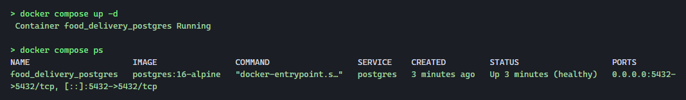

### 6.2. Запуск `npm run start:dev`: підключення до БД і DDL `CREATE TABLE`
TypeORM створює enum-тип і таблицю `dishes` з колонками `character varying(120)`, `numeric(8,2)`, `integer`, `boolean`, `enum` і `timestamp with time zone`. Компіляція завершилась із `Found 0 errors`.

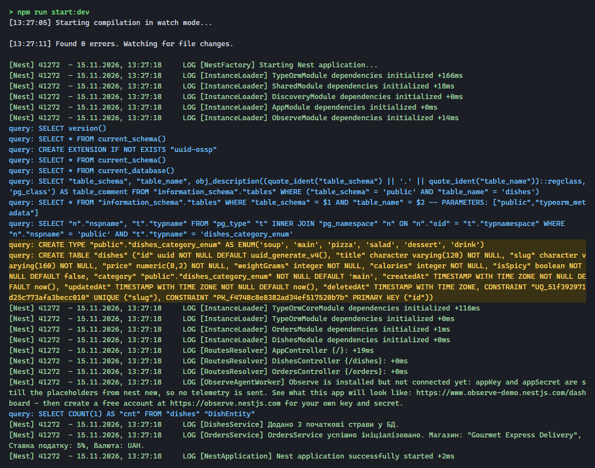

### 6.3. Створення страви (`POST /dishes` → 201)
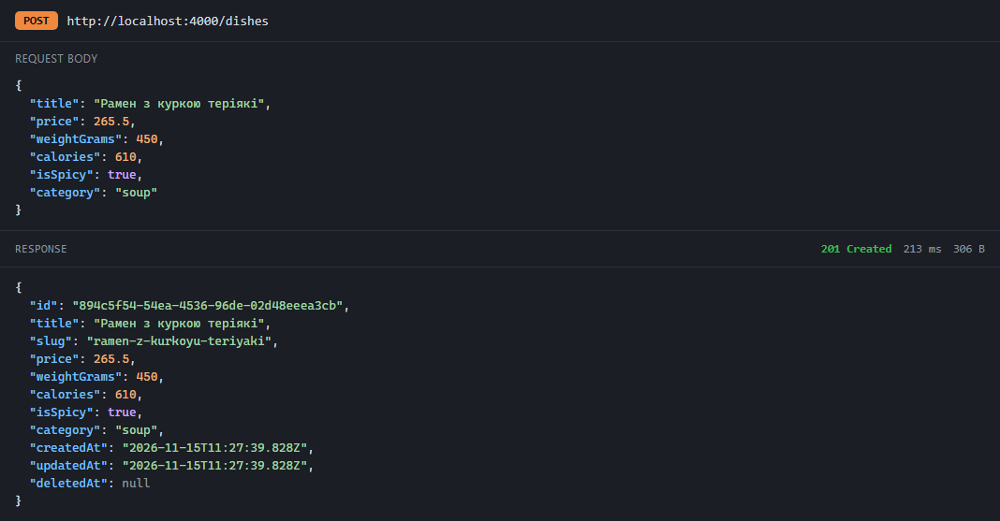

### 6.4. Пагінація та сортування (`page=2&limit=2&sortBy=price&order=ASC`)
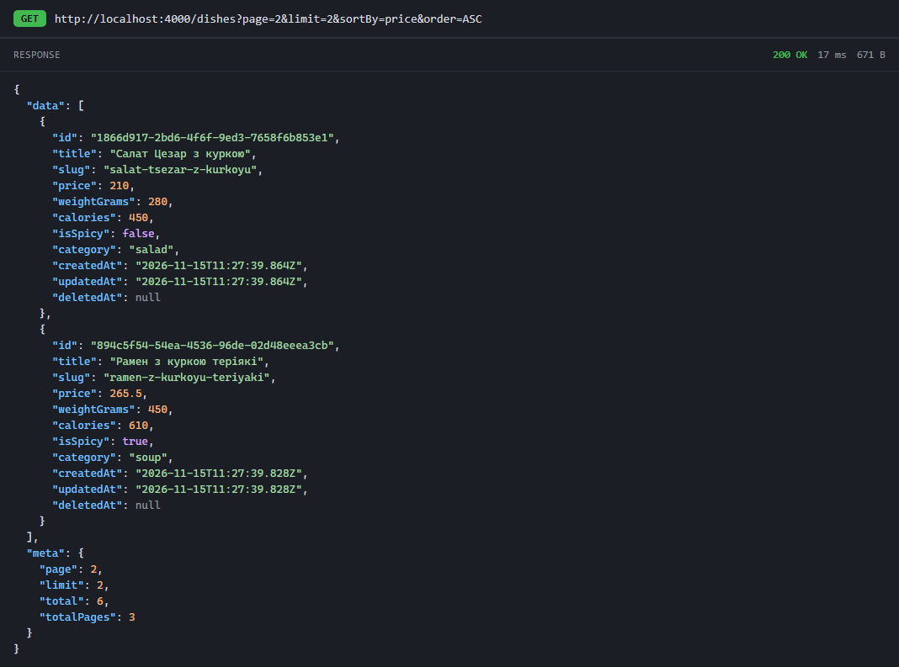

### 6.5. Оновлення (`PATCH /dishes/:id`): змінився `updatedAt`
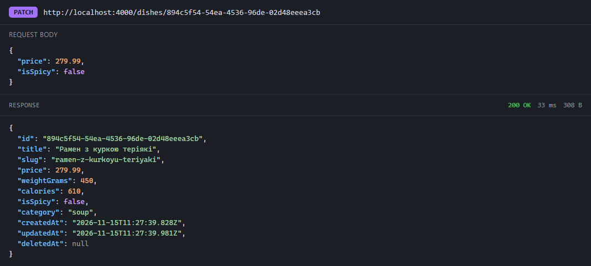

### 6.6. Валідація вхідних даних (400 Bad Request)
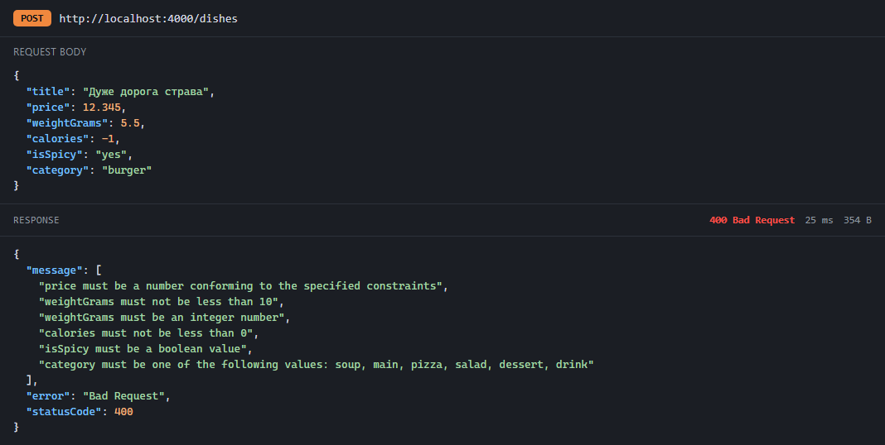

### 6.7. Soft Delete: `DELETE` → 204, далі `GET` → 404, у лозі `UPDATE ... SET "deletedAt"`
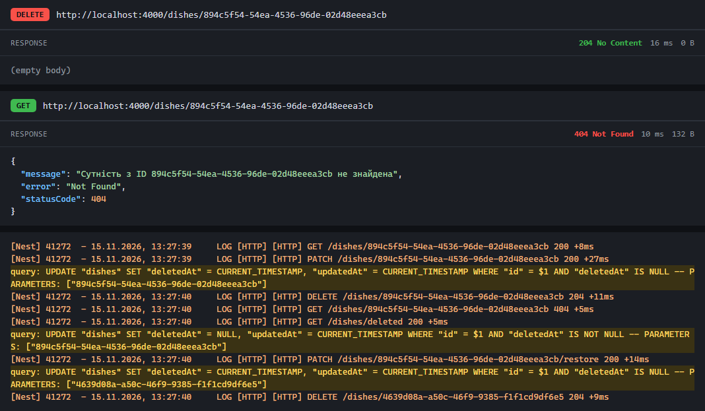

### 6.8. Кошик видалених і відновлення (`/dishes/deleted`, `/dishes/:id/restore`)
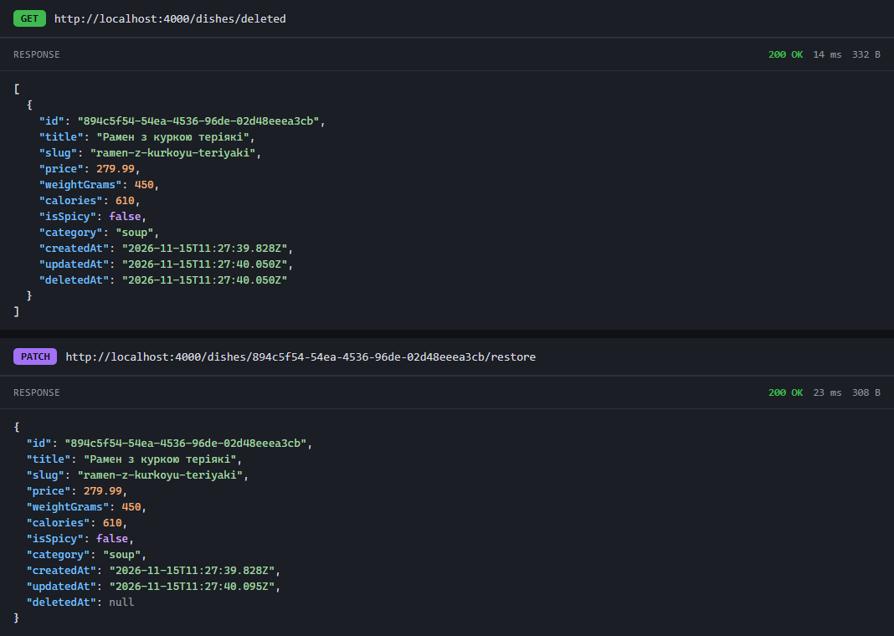

### 6.9. Дані збереглися після повного перезапуску NestJS
Сидування пропущено, бо в базі вже є 6 записів. API повертає `total: 5`, тому що одна страва м'яко видалена.

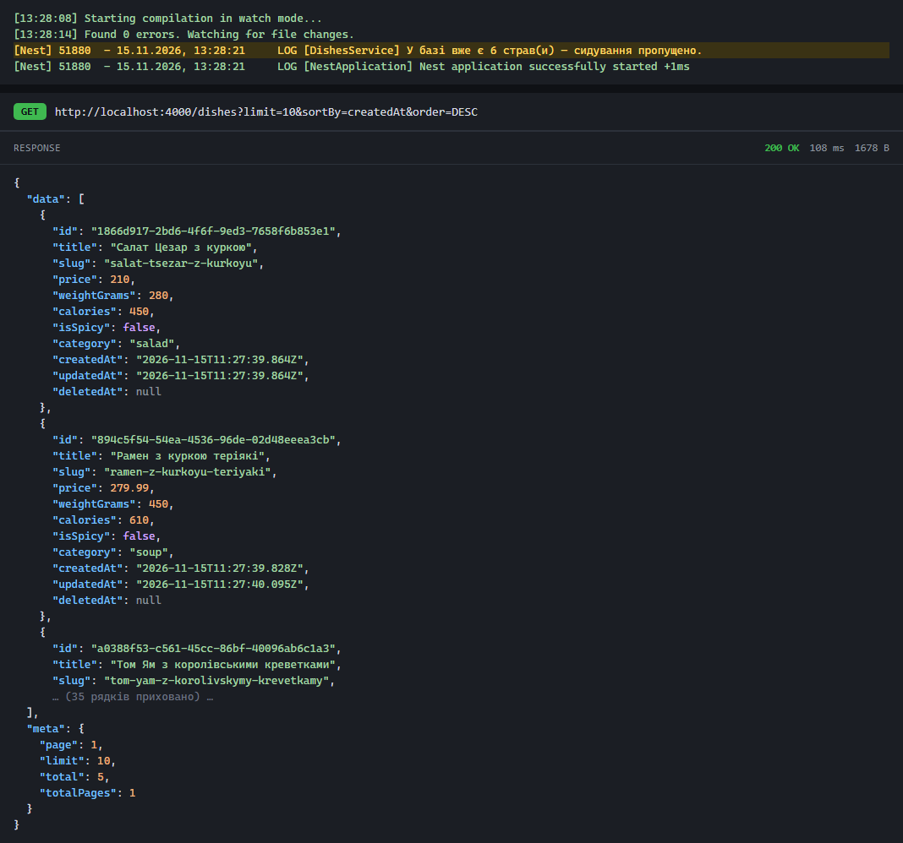

### 6.10. Схема та вміст таблиці в PostgreSQL (`psql`)
М'яко видалений «Чізкейк Нью-Йорк» фізично лишився в таблиці, а `deletedAt` у нього заповнено.

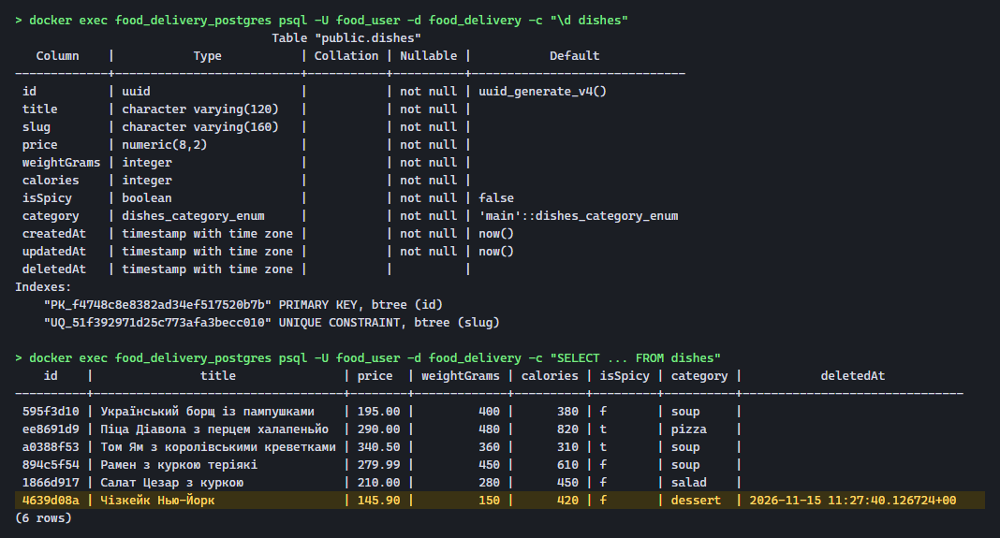

### 6.11. Тести без помилок: юніт (22/22) і e2e на реальній БД (1/1)
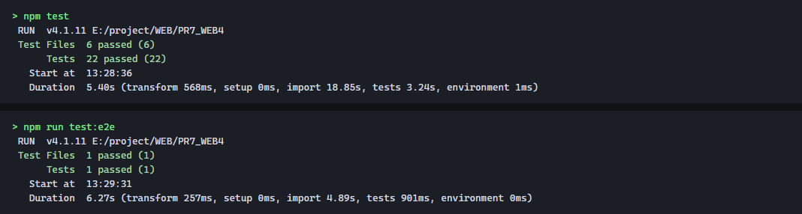

---

## 7. Висновки

In-memory масив замінено на PostgreSQL, розгорнутий у Docker через `docker-compose.yml`. Схему БД TypeORM генерує автоматично з класу `DishEntity` (`synchronize: true`), використовуючи строгі SQL-типи колонок. Сервіс працює з `Repository<DishEntity>`, тож дані зберігаються між перезапусками застосунку. Список страв віддається з offset-пагінацією, метаданими та сортуванням за білим списком полів. Видалення реалізовано як Soft Delete через `@DeleteDateColumn()` з можливістю відновлення.

> `synchronize: true` зручний для навчання та розробки, але в production замість нього використовують міграції TypeORM.
